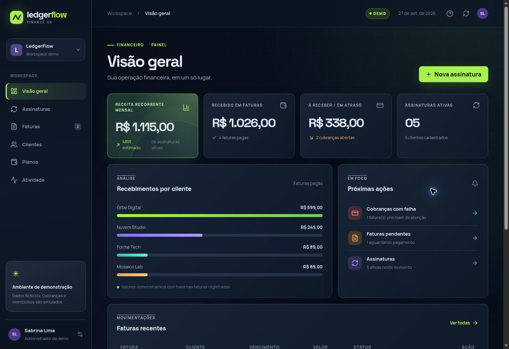

# LedgerFlow

Plataforma demonstrativa de assinaturas e faturamento B2B. Um administrador pode cadastrar clientes e planos, ativar ou cancelar assinaturas, emitir faturas, simular resultados de cobrança e acompanhar indicadores financeiros.

[Abrir demonstração privada](https://ledgerflow-sabrina.limaucello.chatgpt.site)

> O acesso à demonstração depende das permissões do proprietário do Site. Todos os nomes, empresas, e-mails e valores iniciais são fictícios. Nenhum pagamento real é realizado.

## O que funciona

- Clientes e planos cadastrados ficam salvos no banco.
- Uma assinatura cria sua primeira fatura pendente. Um novo ciclo pode ser emitido manualmente.
- Faturas aceitam resultado de pagamento aprovado, falha e reembolso simulado; ações inválidas são rejeitadas no servidor.
- Cada evento tem uma chave única. Repetir a mesma chave com o mesmo conteúdo retorna o resultado já processado; usá-la com outro conteúdo gera conflito.
- O painel calcula MRR estimado a partir das assinaturas ativas; receitas recebidas e pendentes vêm das faturas registradas.
- Busca e filtros funcionam nas listas; o histórico mostra eventos de cobrança.
- Na primeira abertura, o servidor insere dados de demonstração idempotentes com identificadores fixos.

## Arquitetura desta versão

- **Interface:** React 19, TypeScript, Vinext, CSS responsivo e componentes acessíveis.
- **API:** route handler TypeScript executado em Cloudflare Workers.
- **Persistência:** Cloudflare D1 (SQLite), com esquema Drizzle e migração versionada na pasta drizzle.
- **Regras:** validação de entrada com Zod e operações com consultas preparadas; valores monetários são inteiros em centavos.
- **Demo:** site privado, sem login por cliente ou organizações separadas.

Fluxo: interface → /api/ledger → validação/regras → D1 → resposta → atualização do painel.

Esta implantação **não usa Node.js como servidor de produção, PostgreSQL nem gateway de pagamento**. O plano original de portfólio prevê React + Node.js + PostgreSQL e pagamentos em ambiente de testes para uma versão posterior. A simulação atual permite examinar o fluxo de produto sem credenciais, armazenamento de cartão ou movimentação financeira. Não descreva este repositório como integração de pagamento real ou como aplicação pronta para clientes.

## Rodar localmente

Requisitos: Node.js 22.13+, pnpm 11 e ambiente compatível com Cloudflare Wrangler.

1. Instale as dependências: pnpm install --frozen-lockfile.
2. Gere a migração novamente apenas se alterar o esquema: pnpm db:generate.
3. Execute pnpm build para produzir dist/server/wrangler.json.
4. Aplique a migração local:
   node --import ./scripts/sites-env.mjs ./node_modules/wrangler/bin/wrangler.js d1 execute DB --local --config dist/server/wrangler.json --persist-to .wrangler/state --file drizzle/0000_big_squadron_supreme.sql
5. Rode pnpm start e abra o endereço informado pelo Wrangler.

Para desenvolvimento da interface, pnpm dev usa o servidor Vinext. O banco local é independente do banco publicado. Não reaplique uma migração já aplicada ao mesmo banco.

## Contrato da API

GET /api/ledger devolve clientes, planos, assinaturas, faturas e eventos. POST /api/ledger recebe um discriminador action:

| action | Campos | Efeito |
| --- | --- | --- |
| customer | name, company, email | Cadastra um cliente com e-mail único. |
| plan | name, description, amountCents, cadence | Cria um plano mensal ou anual. |
| subscription | customerId, planId | Ativa a assinatura e emite a primeira fatura. |
| invoice | subscriptionId | Emite uma fatura pendente. |
| cancel | subscriptionId | Cancela a assinatura sem apagar o histórico. |
| event | invoiceId, eventKey (UUID), type (paid, failed, refunded) | Registra o resultado simulado com chave idempotente. |

Exemplo de corpo: {"action":"event","invoiceId":"i5","eventKey":"f0941d74-599e-4c74-96d7-880917ae7484","type":"paid"}. Use uma chave inédita para uma ação inédita.

## Decisões e próximos marcos

- A apresentação usa um painel de trabalho, pois a tarefa principal é acompanhar e agir sobre cobranças, sem tela de marketing.
- Não são guardados números de cartão. As empresas da demonstração usam .example, um domínio reservado para exemplos.
- O cancelamento interrompe novas emissões manuais da assinatura; faturas existentes continuam visíveis.
- Para uma versão de produção: autenticação por organização e papéis, PostgreSQL + serviço Node.js, webhooks verificados de um provedor de pagamentos em sandbox, transações e restrições adicionais para concorrência, políticas para renovação automática/cobrança recorrente, testes de API e ponta a ponta, observabilidade e pipeline de CI.

## Autoria e uso de IA

O projeto foi construído com assistência do Codex na implementação, no design e na documentação, orientado pela Sabrina Lima. Antes de apresentá-lo em entrevista, revise o código, execute os fluxos, entenda as decisões e consiga explicar os limites acima. A assistência de IA deve ser descrita com transparência; o repositório mostra exatamente o que foi implementado.

A pasta .openai neste pacote contém apenas a configuração de hospedagem e o nome da conexão do banco. Não inclui chave de API, prompt ou código oculto de IA.
